# VeeamAware

[](https://github.com/inspirenxe/veeamaware/actions/workflows/tests.yml)
[](LICENSE)

Notifications for **Veeam Backup & Replication v13** on Windows. Job reports, failures, malware detections, repository space, server health, security analyzer findings and scheduled digests go to **Discord**, **Microsoft Teams**, any **JSON webhook**, or a target you write yourself.

It works on **Community Edition**, it never slows down or fails a backup job, and it needs no extra software: VBR 13 already installs everything VeeamAware uses.

Reports say *why* something failed, not just that it did. For example, an agent backup that fails after a VBR upgrade because the agent on the machine is out of date:

<table>
<tr><th>Discord</th><th>Microsoft Teams</th></tr>
<tr>
<td valign="top">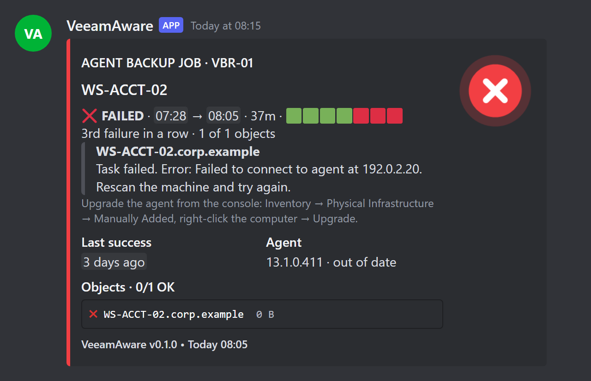</td>
<td valign="top">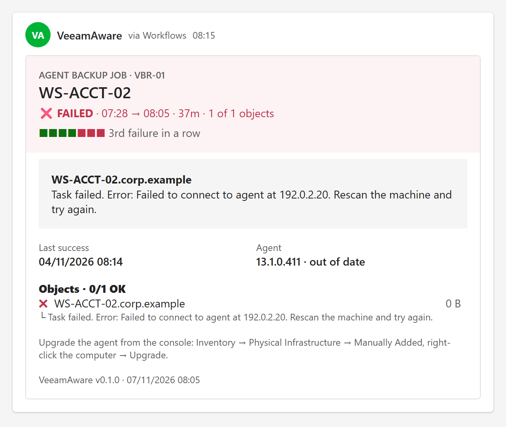</td>
</tr>
</table>

More examples are in the [gallery](#gallery). Every name, address and number in them is made up.

VeeamAware is an independent community project. It isn't affiliated with, endorsed by or supported by Veeam Software. Veeam and Veeam Backup & Replication are trademarks of Veeam Software. It takes its cue from tigattack's [VeeamNotify](https://github.com/tigattack/VeeamNotify) but was written from scratch for v13 and contains none of its code.

> Version 0.1.0. It runs daily on a Community Edition server, but much hasn't been tried on other setups yet; see [Project status](#project-status).

**Contents:** [What you get](#what-you-get) · [Gallery](#gallery) · [Install](#install) · [Updating](#updating) ·
[How it works](#how-it-works) · [Configuration](#configuration) · [Server health](#server-health) · [Targets](#targets) ·
[Troubleshooting](#troubleshooting) · [Uninstall](#uninstall) · [Security](#security) · [Project status](#project-status) ·
[How it's made](#how-its-made) · [License](#license)

## What you get

| Notification | When |
|---|---|
| **Job report**: result, transferred data, duration against the usual run, bottleneck, per-object status, warning and error lines, a 7-run history strip, repository space | When the job ends (post-job hook), or within a few minutes from the watcher |
| **Failure or warning** of any job, including Veeam Agent jobs and agent policies | Immediately, or in the digest. You decide per job with [routing rules](#routing). |
| **Malware detection** events | Watcher (every 5 minutes by default) |
| **Repository** low on space, offline, or recovered, with a "full in ~N days" estimate | Watcher |
| **Security & Compliance Analyzer**: new violations | Watcher, after each analyzer run |
| **Four-eyes** authorization requests (REST data source only) | Watcher |
| **Server health**: Veeam services stopped for more than 15 minutes, jobs that appear stuck, the watcher itself failing, VBR updated. Quiet during Veeam upgrades and [maintenance](#server-health). | Watcher |
| **Digests**: every job's last 7 days, what needs attention, storage, security | On each digest's own schedule (daily at 08:00 by default) |

### Gallery

Each card is one report rendered for both targets. Discord gets embeds with a status badge and coloured tables; Teams gets an Adaptive Card that shows times in each reader's own time zone.

<details>
<summary><b>Successful job</b>: throughput, duration against the usual run, every object, repository space</summary>

| Discord | Teams |
|---|---|
| 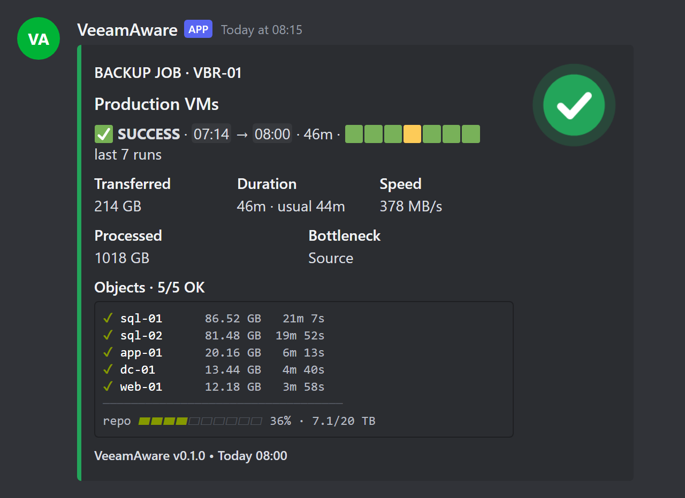 | 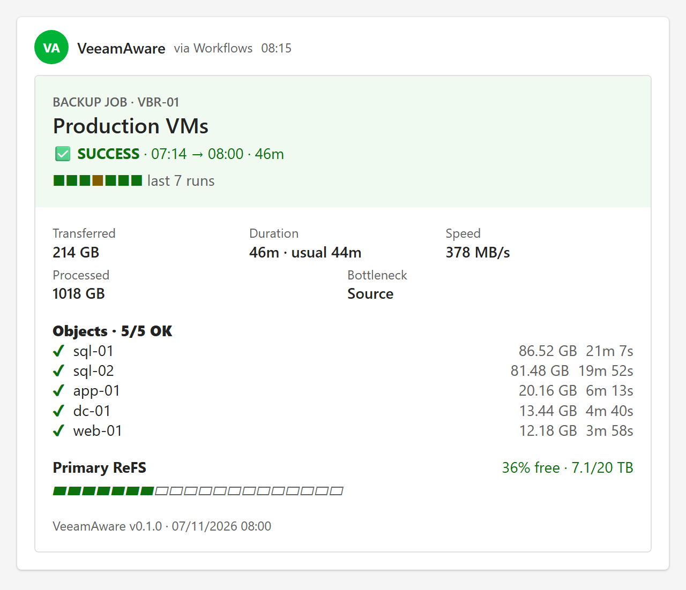 |
</details>

<details>
<summary><b>Job with warnings</b>: what went wrong, quoted from Veeam, and which object</summary>

| Discord | Teams |
|---|---|
| 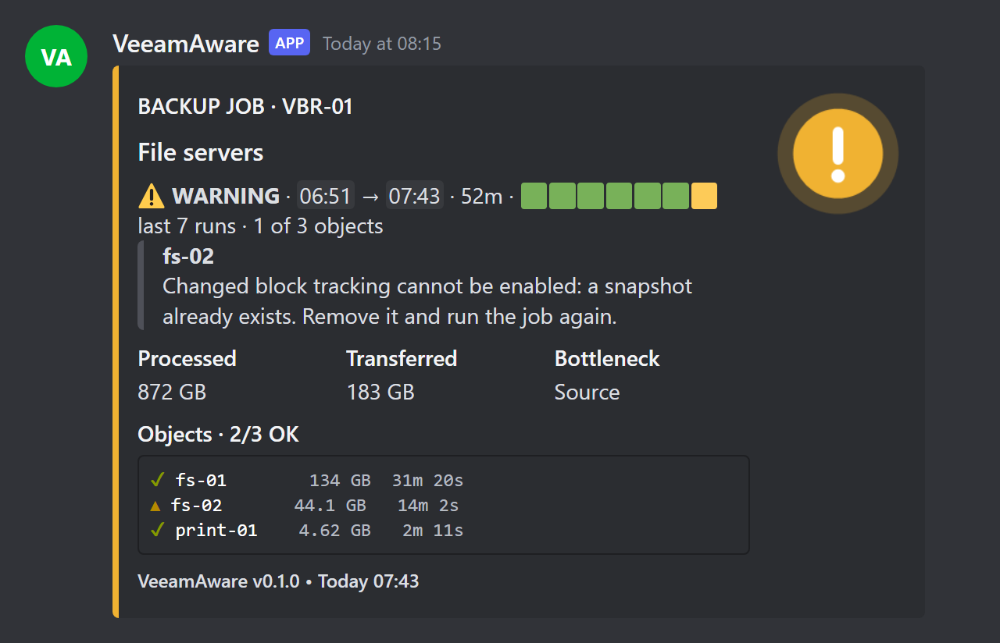 | 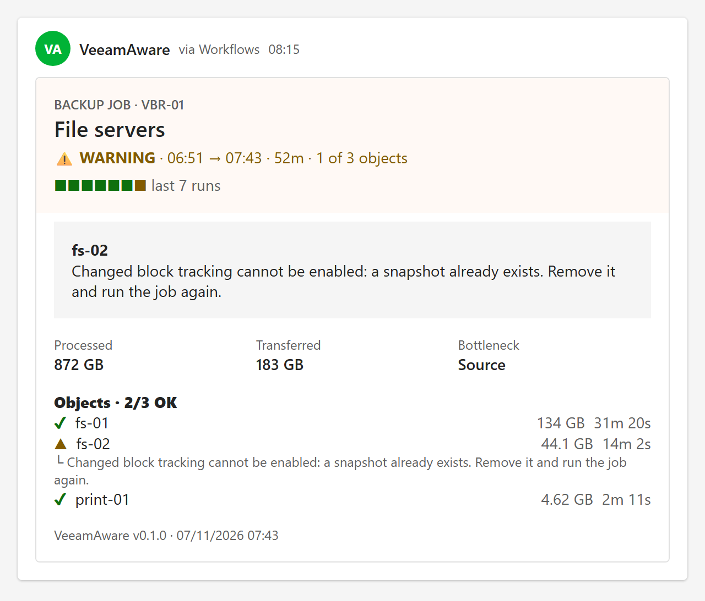 |
</details>

<details>
<summary><b>Daily digest</b>: what needs attention first, then every job's last 7 days, storage and security</summary>

| Discord | Teams |
|---|---|
| 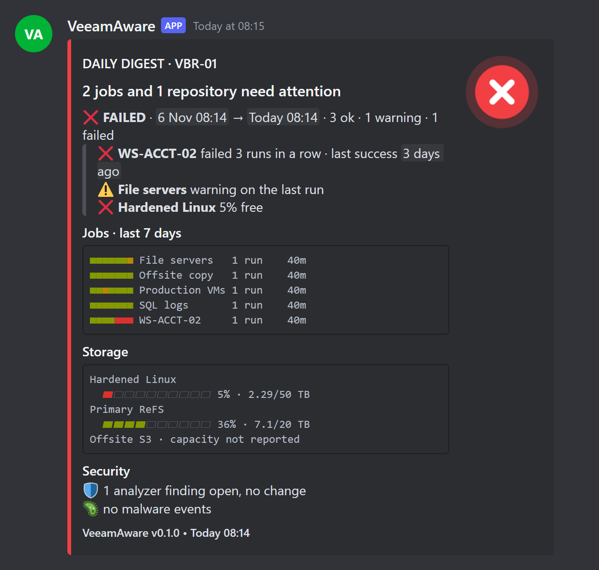 | 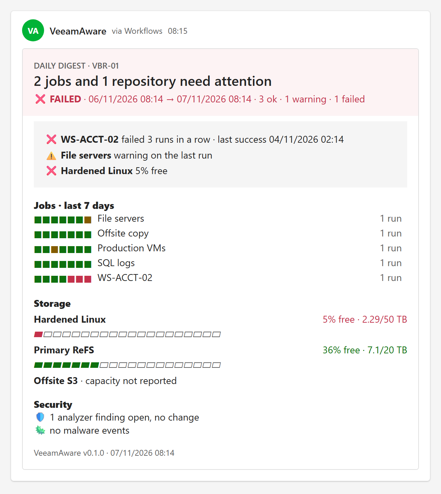 |
</details>

<details>
<summary><b>Repository low on space</b></summary>

| Discord | Teams |
|---|---|
| 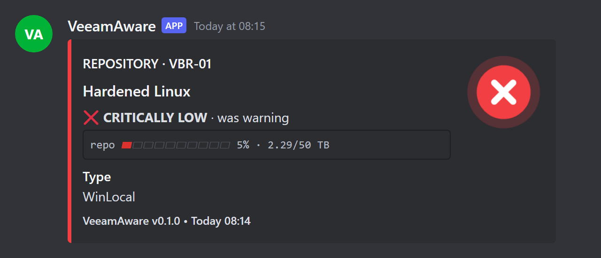 | 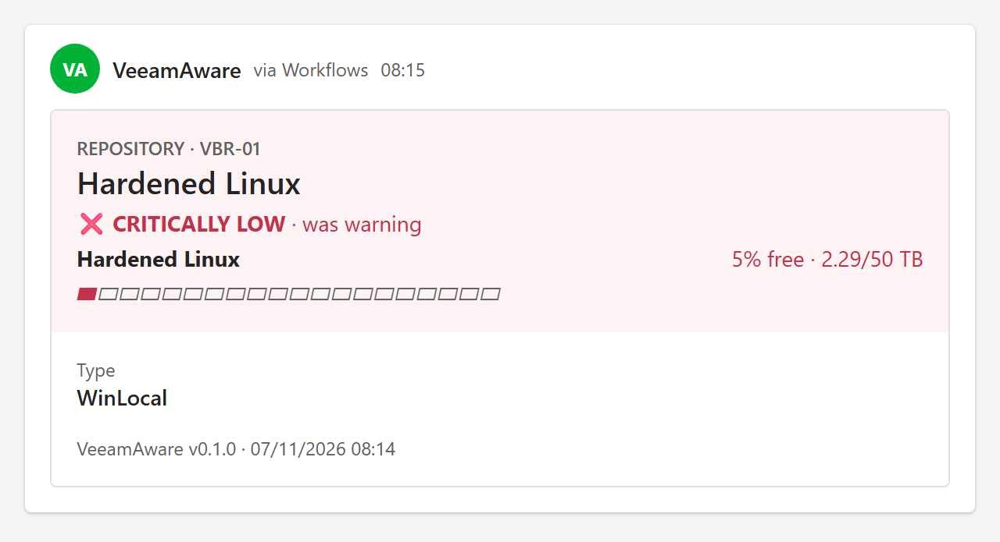 |
</details>

<details>
<summary><b>Malware detection</b></summary>

| Discord | Teams |
|---|---|
| 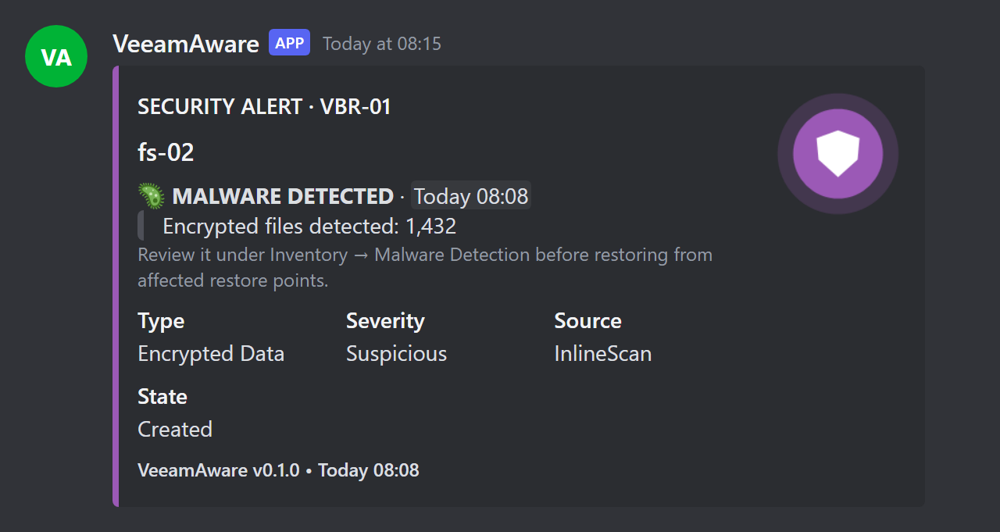 | 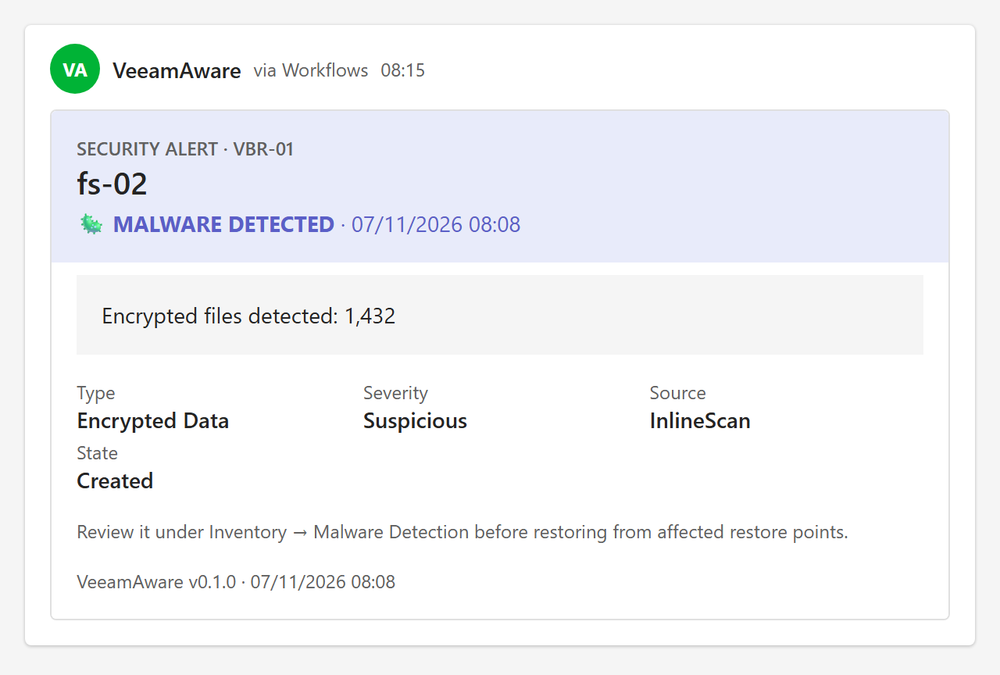 |
</details>

<details>
<summary><b>Server health</b>: a Veeam service stopped, with the reason Windows logged</summary>

| Discord | Teams |
|---|---|
| 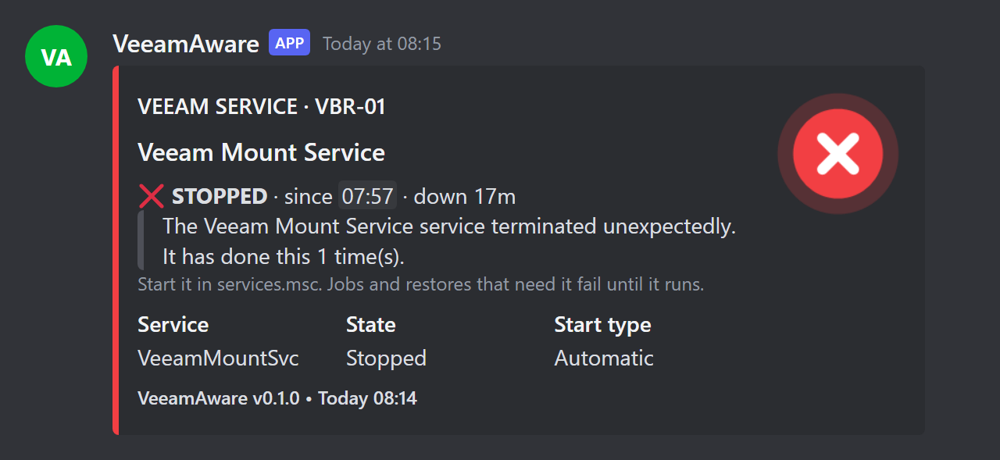 | 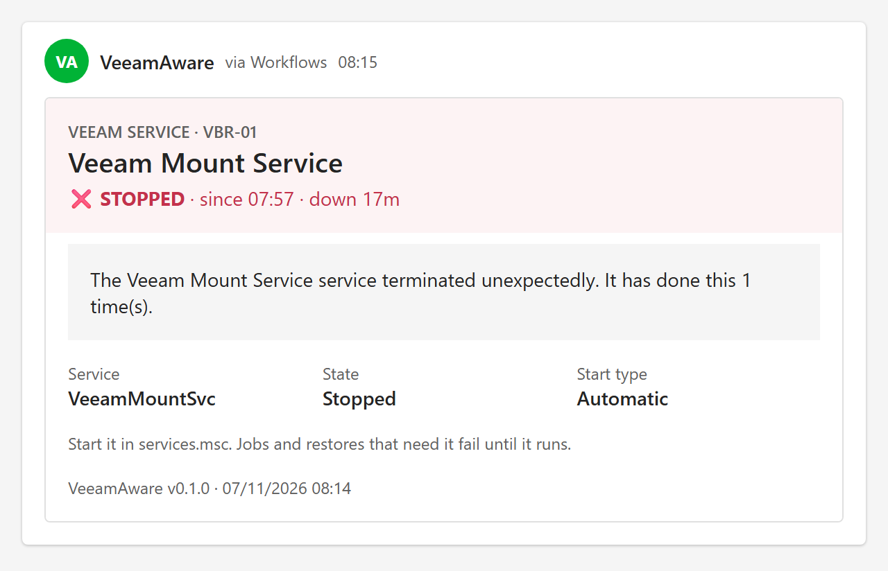 |
</details>

To see these in your own channels, run `pwsh -File C:\VeeamAware\tools\New-SampleCards.ps1 -Send` (add `-Target <name>` for one target). The cards are titled `[Sample]` and use the same made-up data. Nothing is read from VBR.

## Install

On the VBR server, in an **elevated** PowerShell window (Windows PowerShell or PowerShell 7):

```powershell
irm https://raw.githubusercontent.com/inspirenxe/veeamaware/main/install.ps1 | iex
```

This downloads the newest stable release to `C:\VeeamAware` and then:

- walks you through the setup:
  - your notification targets: any number of Discord channels, Teams channels and JSON webhooks, each with what it should receive (everything, warnings and failures, or failures only),
  - health alerts: on or off, how long a service must be down before the first alert, how often to remind you while it stays down, and how long it must run again before "recovered",
  - the digest schedule, and how Veeam Agent results should arrive,
- checks that it can read VBR,
- sends a "connected" message to each target,
- registers one scheduled task,
- offers to attach the post-job hook to your jobs.

You can skip targets during setup and add them later.

**Changing settings later.** Run `C:\VeeamAware\Install-VeeamAware.ps1` again, or the one-liner. On an existing install it shows what is set now and lets you change any part of it; every prompt defaults to the current value, so Enter keeps it. Only what you change is written to `config\config.json`, and your own edits to the file are kept.

```text
    1  Targets        discord, oncall, teams
    2  Health alerts  on, alert after 15 min, repeat every 1 h
    3  Digest         'daily' daily at 08:00
    4  Agent jobs     failures right away, the rest in the digest
    5  Watcher        every 5 min
    6  Data source    auto
    7  Updates        stable channel
    8  Post-job hook  review, attach or remove

Change which (number, or Enter to save and finish):
```

For unattended installs, pass targets as `type[:name][@severity]=url`. This works with the installer directly or through the bootstrap's `-InstallerArguments`:

```powershell
.\Install-VeeamAware.ps1 -NoPrompt -Target discord=https://discord.com/api/webhooks/…, teams:ops@warning=https://…
```

Then attach the post-job hook, so reports arrive the moment a job ends:

```powershell
cd C:\VeeamAware
.\Register-VeeamAwareJob.ps1          # review: lists jobs and the exact command for each
.\Register-VeeamAwareJob.ps1 -Apply   # attach the hook to VM, copy and file jobs
```

Agent jobs keep their script settings per job, so `Register-VeeamAwareJob.ps1` prints the command to paste into each one. Agent policies never run post-job scripts. The watcher reports their sessions, and those of any job without the hook, within a few minutes.

**Options for the one-liner.** Run it as a script block to pass parameters:

```powershell
& ([scriptblock]::Create((irm https://raw.githubusercontent.com/inspirenxe/veeamaware/main/install.ps1))) -Channel preview -Path D:\VeeamAware
```

**Without the one-liner.** Download a release zip from [Releases](https://github.com/inspirenxe/veeamaware/releases) and extract it. Run `Get-ChildItem -Recurse | Unblock-File`, then run `.\Install-VeeamAware.ps1` from PowerShell 7.

### Requirements

- Windows VBR **13.0.x or 13.1.x**. Tested on 13.1.0.411 and 13.1.1.700, Community Edition.
- **PowerShell 7**. VBR 13 installs it (`C:\Program Files\PowerShell\7\pwsh.exe`). The v13 Veeam module doesn't load in Windows PowerShell 5.1, so every VeeamAware script except the bootstrap runs under `pwsh`.
- Somewhere to send notifications: a Discord webhook (channel → Edit → Integrations → Webhooks), a Teams channel, or any URL that accepts JSON.

## Updating

```powershell
C:\VeeamAware\Update-VeeamAware.ps1 -Check             # what's available
C:\VeeamAware\Update-VeeamAware.ps1                    # install the newest release on your channel
C:\VeeamAware\Update-VeeamAware.ps1 -Channel preview   # switch channel (saved to the config) and update
C:\VeeamAware\Update-VeeamAware.ps1 -Tag v0.1.0        # install a specific release, e.g. to go back
```

| Channel | Gets |
|---|---|
| `stable` (default) | Full releases only |
| `preview` | Pre-releases as well as full releases, whichever is newer |

Updates come from this repository's GitHub releases.
- The updater pauses the watcher while it replaces files.
- It never touches `config\config.json`, `secrets\`, `state\`, `logs\` or your files in `plugins\`.
- When a newer release is out on your channel, the digest says so in its footer. Set `update.notify` to `false` to turn that off.

## How it works

- **The hook does almost nothing.** VBR keeps a job open until its post-job script exits. `VeeamAware.ps1` starts a detached worker and exits `0` immediately, so it can't delay or fail a job. The worker waits for the session to finish, then reports.
- **The watcher** (`Invoke-VeeamAwareWatch.ps1`, a scheduled task running as SYSTEM) runs every few minutes. It reports sessions the hook didn't, malware events, repository changes and analyzer results, and it starts digests when they are due.
- **Nothing is sent twice.** The hook worker and the watcher claim session IDs in `state\state.json` under a machine-wide lock.
- **One report, many targets.** Each notification is built once as a neutral report. Each target renders it its own way: Discord embeds, a Teams Adaptive Card, or plain JSON.

## Data sources

`vbr.dataSource` decides where VeeamAware reads VBR data:

| Value | Reads through | Use for |
|---|---|---|
| `auto` (default) | REST when a credential is stored and the API serves data, otherwise PowerShell | Most installs |
| `powershell` | The local `Veeam.Backup.PowerShell` module, as the account running the script. No stored credential. | **Community Edition**, whose REST API answers data calls with `License restrictions apply.` |
| `rest` | The VBR REST API (1.3-revN) with a stored VBR account | Licensed editions. Run `.\Install-VeeamAware.ps1 -UseRest` to store the account. |

For REST, a dedicated account with the *Veeam Backup Viewer* role covers job reports, sessions and repositories. Malware, analyzer and four-eyes events may need *Security Administrator*. Features the role can't read are logged and skipped.

The PowerShell source reads some properties Veeam doesn't document, such as session progress, backup statistics and repository containers. Their names aren't in the code. They live in **versioned profiles** in `src\Profiles\PowerShell\`:

- `13.0.psd1` is the base for every 13.x build. Profiles at or below the installed module's version are merged in order.
- Supporting a new build means adding `13.2.psd1`, `14.0.psd1` and so on, containing only the keys that changed. Each field also lists fallback names, so small renames need no new profile.
- `vbr.powershellProfile` points at a local `.psd1` that is merged last. Use it to fix a property on your server without editing code.
- `tools\Probe-VeeamPowerShell.ps1` dumps the real property names on a server. That output is what a new profile is written from.

## Configuration

`config\config.json` is created from [`config\config.example.json`](config/config.example.json) on first install. Any key you leave out uses its default.

| Key | Default | Notes |
|---|---|---|
| `discord.webhookUrl` | — | Leave empty if you only use other targets |
| `discord.threadId` | `""` | Post into a thread or forum post |
| `discord.mentions.onFailure` / `onWarning` / `onSuccess` / `onSecurity` | `[]` | e.g. `["<@123>", "<@&456>"]` (user, role) |
| `discord.statusBadges` | `true` | A small coloured status badge as each report's thumbnail |
| `discord.ansiColors` | `true` | Coloured tables on Discord desktop and web. Mobile shows them plain. |
| `notifications.objectDetail` | `all` | `all` / `problems` / `none`: the per-object table on job reports |
| `watch.intervalMinutes` | `5` | Re-run `Install-VeeamAware.ps1` after changing it |
| `watch.repositories.warnPercentFree` / `criticalPercentFree` | `15` / `5` | |
| `watch.repositories.exclude` | `[]` | Repository names, wildcards allowed |
| `watch.health.*` | see [Server health](#server-health) | Services, stuck sessions, watcher failures, upgrades |
| `vbr.dataSource` | `auto` | See [Data sources](#data-sources) |
| `vbr.port` | `443` | REST only. Use `9419` on 13.0.x. |
| `update.channel` | `stable` | `stable` / `preview` |
| `update.notify` | `true` | Mention new releases in the digest |
| `logging.level` | `Info` | `Debug` logs every Veeam call |

### Routing

`routing.rules` decides what happens to each finished session. Rules are checked in order and the first match wins. Each result (`success`, `warning`, `failure`) maps to `immediate`, `digest`, `both` or `off`. A job no rule matches is reported immediately.

```json
"routing": { "rules": [
  { "name": "Agents: failures now, the rest in the digest",
    "match": { "jobTypes": ["AgentBackup", "AgentPolicy"] },
    "success": "digest", "warning": "digest", "failure": "immediate" },
  { "name": "Lab jobs: digest only",
    "match": { "jobs": ["LAB-*"] },
    "success": "digest", "warning": "digest", "failure": "digest" },
  { "name": "Everything else",
    "match": { "jobs": ["*"] },
    "success": "immediate", "warning": "immediate", "failure": "immediate" }
]}
```

`match` takes `jobs` (name wildcards), `jobTypes` (e.g. `BackupJob`, `BackupCopyJob`, `ReplicaJob`, `AgentBackup`, `AgentPolicy`) and `exclude`.

### Digests

Each entry in `digests` is a separate summary with its own schedule, jobs, sections and targets:

```json
"digests": [
  { "name": "daily", "schedule": { "every": "day", "at": "08:00" }, "targets": ["*"],
    "jobs": { "include": ["*"] }, "sections": ["agents", "jobs", "repositories", "security"] },
  { "name": "weekly-management", "schedule": { "every": "week", "day": "Monday", "at": "09:00" },
    "targets": ["teams"], "sections": ["jobs", "repositories"], "skipWhenEmpty": true }
]
```

| Key | Notes |
|---|---|
| `schedule` | `every`: `day` or `week` (then also `day`), and `at` (local time, HH:mm) |
| `targets` | Target names, or `*` for all |
| `jobs` | `include`, `exclude`, `jobTypes`, same as routing `match` |
| `content` | `all` (every session) or `routed` (only sessions routed to `digest` or `both`) |
| `sections` | Any of `agents`, `jobs`, `repositories`, `security` |
| `skipWhenEmpty` | Don't send a digest with nothing in it |

The watcher sends each digest when it's due, so schedule changes need no reinstall. To preview one: `.\Invoke-VeeamAwareDigest.ps1 -Name daily -WhatIf`.

### Server health

The watcher checks the server on every pass. Health events have kind `health`, so a target can take or skip them with `kinds`.

#### Alert timing

Three timings apply to every check. The installer asks for them, and they live under `watch.health`. Any check can override them, for example `watch.health.services.repeatEveryMinutes`.

| Setting | Default | Meaning |
|---|---|---|
| `firstAlertAfterMinutes` | `15` | How long a problem must last before the first alert. Hides reboots and service restarts. |
| `repeatEveryMinutes` | `60` | How often to remind you while it lasts. `0` alerts once. |
| `backUpForMinutes` | `5` | How long a service must run again before "running again" is sent. |

#### What is checked

| Check | Alerts when | Settings (`watch.health.…`) |
|---|---|---|
| **Services** | A watched service has been stopped for `firstAlertAfterMinutes` | `include`, `exclude`, `required`, `notifyRecovery` |
| **Stuck sessions** | A session runs far longer than usual, or its progress stops moving | `sessions.*` |
| **Watcher** | The watcher fails 3 runs in a row, for example when VBR is unreachable | `watcher.failureAlertAfter`, `notifyRecovery` |
| **VBR updated** | VBR's version changed since the last pass (information only) | `upgrade.notifyVersionChange` |

**Services**
- Watched: automatic-start services matching `include` (`Veeam*`, `postgresql*`, `MSSQL$VEEAMSQL*`, by name or display name), plus `required` (`VeeamBackupSvc`), which is reported as *Missing* if it disappears.
- One alert lists every stopped service. Reminders follow while any stays down.
- "Running again" goes out once they have all run for `backUpForMinutes`. A service that drops again inside that window counts as the same outage.

**Stuck sessions**
- A session is stuck when it has run 3× longer than the job usually takes (`usualFactor`), or its progress hasn't moved for 4 hours (`noProgressMinutes`).
- Never before 2 hours (`minHours`), and 12 hours for a job with no history (`hours`).
- Per-job limits: `jobs`, e.g. `[{ "job": "File server*", "hours": 24 }]`. Skip jobs with `excludeJobs`.
- Backup copy and idle sessions are skipped, since they stay open by design.
- The alert shares the job's fingerprint, so the job's own report resolves it.

**Watcher**
- Failures while services are down or Veeam is upgrading don't count.
- If the scheduled task stops running altogether, the next post-job hook reports it, once a day.

#### During Veeam upgrades

Health alerts pause while a Veeam installer runs. VeeamAware treats these as an installer:

- a process named like one in `upgrade.processNames`
- `msiexec` or a setup process whose path or command line mentions Veeam
- a setup-like program published by Veeam, or anything started from a CD/ISO drive. This covers `Setup.exe` on a mounted VBR ISO.
- Windows Installer busy (an install in progress, or its service running), but only while Veeam services are down

The Veeam Updater processes that always run never count.

While an installer runs:
- The watcher skips its VBR checks and digests, so it never loads Veeam's PowerShell module while files are being replaced. It catches up on the next run.
- Alerts stay paused until `upgrade.quietMinutes` (30) after the installer finishes or VBR's version changes. The service timers then start over.
- A signal that lasts longer than `upgrade.maxHours` (6) stops pausing alerts, so a lookalike process can't silence them for good.

To see what VeeamAware detects, run `tools\Probe-Health.ps1 -NoVbr` during an upgrade. It doesn't touch VBR.

#### Maintenance mode

For other planned work, pause health alerts by hand. Job reports and the other alerts still go out.

```powershell
C:\VeeamAware\Set-VeeamAwareMaintenance.ps1 -Minutes 120 -Reason 'Windows updates'
C:\VeeamAware\Set-VeeamAwareMaintenance.ps1 -Off
C:\VeeamAware\Set-VeeamAwareMaintenance.ps1          # show the current state
```

Digests add a line when a service is down, the watcher is failing, or maintenance mode is on.

## Targets

The top-level `discord` block is a target named `discord`. Add more targets under `"targets": [...]`. The examples in `config.example.json` ship disabled.

| Type | What it does |
|---|---|
| `discord` | Embeds with status badges, coloured tables, mentions, threads |
| `teams` | Adaptive Card in a Teams channel. Times show in each reader's time zone. |
| `webhook` | POSTs the event as JSON (`veeamaware.event/v1`) to any URL: n8n, Home Assistant, Power Automate, your own API |
| *plugins* | Any `.ps1` in `plugins\targets\`. See [docs/writing-a-target.md](docs/writing-a-target.md). |

Options for every target:

| Option | Default | Notes |
|---|---|---|
| `minSeverity` | `info` | `info` / `warning` / `critical` |
| `kinds` | `["*"]` | Any of `session`, `malware`, `repository`, `analyzer`, `authorization`, `health`, `digest` |
| `includeResolved` | `true` | Send "problem cleared" events |
| `includeDeferred` | `false` | Also send sessions that routing sends to the digest, as they finish |
| `enabled` | `true` | |

### More than one channel

Add as many targets as you like, of any type, each with a unique `name`. For example, a second Discord channel that only gets failures and pings the on-call role:

```json
"targets": [
  { "type": "discord", "name": "oncall", "webhookUrl": "https://discord.com/api/webhooks/…",
    "minSeverity": "critical", "username": "Backup alerts",
    "mentions": { "onFailure": ["<@&123456789012345678>"] } }
]
```

Every `discord.*` setting (`threadId`, `username`, `avatarUrl`, `mentions`, `statusBadges`, `ansiColors`) also works on a Discord entry in `targets`, so each channel is set up separately. The top-level `discord` block stays the target named `discord`. To send a digest to just one channel, list its name in the digest's `targets`.

`.\Test-VeeamAwareTarget.ps1` sends a test to every target, or `-Target <name>` for one. Add `-WhatIf` to print the payloads instead. `-ListTypes` shows the installed types and any plugin that failed to load.

### Microsoft Teams

1. In Teams, open the channel's **⋯** menu, choose **Workflows**, then **Post to a channel when a webhook request is received**. Finish the wizard and copy the URL.
2. Add the target: `{ "type": "teams", "name": "teams", "url": "https://…", "minSeverity": "warning" }`
3. Run `.\Test-VeeamAwareTarget.ps1 -Target teams`.

Workflow webhooks can't @mention people, so Teams has no `mentions` option. Long reports are shortened to fit Teams' 28 KB limit.

### Generic webhook

```json
{ "type": "webhook", "name": "n8n", "url": "https://n8n.example.com/webhook/veeam",
  "minSeverity": "warning", "tokenFile": "secrets\\n8n-token.json", "signingSecretFile": "secrets\\n8n-hmac.json",
  "headers": { "X-Env": "prod" } }
```

Store the token and signing secret with `.\Set-VeeamAwareSecret.ps1 -Path secrets\n8n-token.json`. They're encrypted with DPAPI and can only be read on this machine.

The body (`veeamaware.event/v1`) has:
- `schema` and `id`
- `kind`: `session` / `malware` / `repository` / `analyzer` / `authorization` / `health` / `digest` / `test`
- `severity`: `info` / `success` / `warning` / `critical`
- `status`, `title`, `text` (plain) and `markdown`
- `fingerprint`: a stable key for "the same problem", e.g. `vbr/<server>/job/<jobId>`
- `resolved`, `deferred`, `occurredAt` and `source`
- `details`: structured data such as per-object results, byte counts and repository space
- `report`: the neutral layout chat targets render (`veeamaware.report/v1`). It can be `null`.

Headers on every request:
- `X-VeeamAware-Event: <kind>` and `X-VeeamAware-Delivery: <id>`
- `Authorization: Bearer …` with `tokenFile`
- `X-VeeamAware-Signature: sha256=<hex HMAC-SHA256 of the raw body>` with `signingSecretFile`

Deliveries are retried on 429 and 5xx, and one failing target never blocks the others.

## Troubleshooting

Logs are in `logs\` (`hook-*`, `session-*`, `watch-*`, `digest-*`). Digest logs include a `Timing:` line for each step.

```powershell
.\Invoke-VeeamAwareSession.ps1 -JobId <guid> -WhatIf    # print the report for the job's latest session
.\Invoke-VeeamAwareSession.ps1 -SessionId <guid> -Force # re-send a session
.\Invoke-VeeamAwareDigest.ps1 -Name daily -Hours 24 -WhatIf
.\Invoke-VeeamAwareWatch.ps1 -WhatIf
pwsh -NoProfile -File .\tests\Run-Tests.ps1             # offline tests, no VBR needed
pwsh -File .\tools\New-SampleCards.ps1 -Send            # post sample cards (made-up data) to your targets
pwsh -File .\tools\Send-HealthPreview.ps1               # post every server-health card the same way
```

To find a job's GUID: `(Get-VBRJob -Name 'My Job').Id`, or `Get-VBRComputerBackupJob` for agent jobs.

## Uninstall

```powershell
C:\VeeamAware\Uninstall-VeeamAware.ps1                # remove the hook from jobs and the scheduled task; keep the folder
C:\VeeamAware\Uninstall-VeeamAware.ps1 -RemoveFiles   # also delete C:\VeeamAware (config, secrets, state, logs)
```

- The hook is removed only where the job's post-job script runs `VeeamAware.ps1`. Other scripts are left alone.
- Agent, file-share, tape and SureBackup jobs keep their script settings per job, so the uninstaller lists those for you to check by hand.
- `Register-VeeamAwareJob.ps1 -Remove` previews the hook removal without uninstalling.

## Security

- `config\`, `secrets\`, `state\`, `logs\` and `plugins\` are limited to SYSTEM and Administrators. Webhook URLs are secrets: anyone who has one can post to your channel.
- The REST credential and target secrets are encrypted with DPAPI (machine scope), so the SYSTEM tasks and administrators on this machine can read them, and nobody can read them elsewhere.
- Plugins run as SYSTEM. Only add plugins you trust.

## Project status

VeeamAware is young. What has been run against a real server so far:

| Area | Status |
|---|---|
| Discord, PowerShell data source, Community Edition 13.1 | In daily use |
| Generic webhook | Covered by the offline tests (payload, headers, signing). Not yet tested against a live receiver. |
| Microsoft Teams (Workflows webhook) | Tested: connection card, job report, digest |
| REST data source on a licensed edition | Built against the documented API. Not yet tested on a licensed server. |
| VBR 13.0.x | Not tested |
| Server health (services, stuck sessions, upgrade detection) | Service outage, reminders and recovery, and a real VBR 13 upgrade from the ISO, tested on a live server. Stuck sessions are covered by the offline tests only. |

Reports from other setups are very welcome. See [CONTRIBUTING.md](CONTRIBUTING.md). To report a security problem, see [SECURITY.md](SECURITY.md).

The gallery images are rebuilt from made-up data with `pwsh -File .\tools\New-ReadmeImages.ps1`. It renders each card with the real renderers into `tools\card-preview.html` and screenshots it in headless Edge. Teams cards are drawn by Microsoft's Adaptive Cards renderer. The Discord layout is a close imitation, since Discord has no public renderer.

## How it's made

VeeamAware is built with AI assistance. Its code, tests and documentation are written with
[Claude Code](https://claude.com/claude-code), Anthropic's coding agent, under the maintainer's direction: they
decide what goes in and try it out on a real VBR server. Every commit says so with a `Co-Authored-By: Claude`
trailer.

## License

VeeamAware is MIT-licensed, © 2026 InspireNXE. See [LICENSE](LICENSE).

It runs on PowerShell 7 and Veeam's own `Veeam.Backup.PowerShell` module, both installed by VBR 13. The gallery's Teams
cards are drawn with Microsoft's [Adaptive Cards](https://adaptivecards.io/) renderer (MIT) and the Discord emoji with
[Twemoji](https://github.com/jdecked/twemoji) (CC-BY 4.0). Both are loaded only by `tools\card-preview.html`, never by
VeeamAware itself.

VeeamNotify is GPL-licensed. VeeamAware was written from VBR's documented interfaces and its own testing, and contains
none of VeeamNotify's code.
